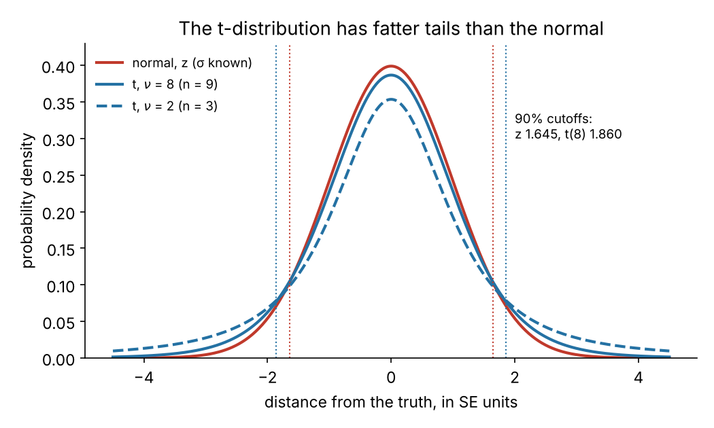
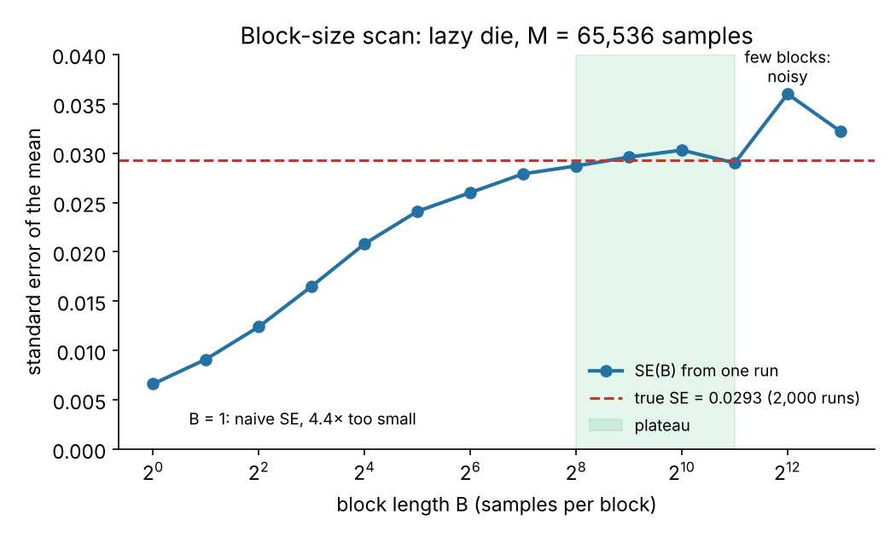

# Lecture 9: Block Averaging and Error Estimation — Complete Notes with Every Derivation

*Based on 9.pdf ("Block Averaging and Error Estimation", 27 January 2022). Every formula in the lecture is derived here step by step, the statements that need correcting are corrected, and every claim is checked with numbers from small simulations. This version also contains the full step-by-step walkthrough: confidence intervals built up with dice, z versus t, reading an interval correctly, the "lazy die" model of correlated data, autocorrelation, and how to calculate block averages and choose the block size, with coding tasks and solutions (Section 21). The two figures are in the `figures` folder next to this file.*

---

## Contents

**Part 0. Orientation**
- 0.1 Notation
- 0.2 Why this lecture matters
- 0.3 The lecture in one page
- 0.4 What the lecture covers, and what these notes add

**Part I. Combining random variables**
- 1. Mean, variance and covariance
- 2. Mean of a linear combination
- 3. Variance of a linear combination
- 4. Identically distributed variables
- 5. The average of n variables: the 1/√n rule

**Part II. Estimating from data**
- 6. Sample mean and sample variance (why n − 1)
- 7. The sample mean is itself a random variable

**Part III. Confidence intervals**
- 8. What "90% confidence" means (built up with dice)
- 9. When σ is known: the normal distribution
- 10. When σ is unknown: Student's t-distribution
- 11. Finding e for a given confidence; z or t?
- 12. Worked example: 2.4 ± 0.1, step by step from raw data
- 13. Reading a confidence interval correctly (and the prediction interval)

**Part IV. Block averaging**
- 14. Why simulation data are correlated (lazy die, autocorrelation, correlation time)
- 15. Error of the mean for correlated data
- 16. Block averages
- 17. Why block averages become independent
- 18. The block-averaging recipe
- 19. Choosing the block size: the plateau
- 20. Worked example on a Monte Carlo chain
- 21. Python code and coding tasks
- 22. Practical checklist

**Part V. Wrap-up**
- 23. Corrections and clarifications to the lecture notes
- 24. Practice questions (with answers)
- 25. Summary: the whole chain

---

# Part 0. Orientation

## 0.1 Notation

| Symbol | Meaning |
|---|---|
| $X$, $X_i$ | random variables (quantities whose value changes from one measurement to the next) |
| $x_i$ | one measured value (a sample) of $X$ |
| $\langle X\rangle$ | true mean (expectation) of $X$; the lecture writes mean$\lbrace X\rbrace$ |
| $\mathrm{Var}(X)$ | true variance of $X$; the lecture writes var$\lbrace X\rbrace$ |
| $\mu_X$, $\sigma_X^2$, $\sigma_X$ | true mean, true variance and true standard deviation of $X$ |
| $\mathrm{Cov}(X_i, X_j)$ | covariance of two random variables |
| $a_i$ | constants in a linear combination |
| $Y$ | a linear combination $a_1X_1 + \dots + a_nX_n$ |
| $n$ | number of samples (or, in block averaging, number of blocks $n_b$) |
| $\bar x$ | sample mean, $\frac1n\sum x_i$ |
| $s_x^2$, $s_x$ | sample variance and sample standard deviation |
| SE | standard error: the standard deviation of the sample mean |
| $C$ | confidence level (e.g. 0.90) |
| $e$ | the critical value: half-width of the interval in units of the standard error |
| $\nu$ | degrees of freedom of a Student t-distribution, $\nu = n - 1$ |
| $M$ | total number of (correlated) samples from a simulation |
| $B$ | block length (samples per block) |
| $n_b$ | number of blocks, $n_b = M/B$ |
| $\bar x^{b}_k$ | average of block $k$ |
| $s_b$ | sample standard deviation of the block averages |
| $z$, $t$ | distance of $\bar x$ from $\mu_X$ in units of the true SE ($z$) or the estimated SE ($t$) |
| $X_{\text{new}}$ | one new measurement (prediction interval) |
| $\rho_k$ | autocorrelation of samples $k$ steps apart |
| $\tau$ | correlation time (steps until $\rho_k$ drops to about 0.37) |
| $g$ | statistical inefficiency (how many correlated samples are "worth" one independent sample) |

## 0.2 Why this lecture matters

Every number a Monte Carlo or molecular-dynamics simulation produces is an **average over a finite run**. Run again with a different random seed and the average changes a little. So every result must be reported with an **error bar**: "$\langle U\rangle/N = -5.506 \pm 0.003$".

The obvious formula for the error bar, $\sigma/\sqrt M$ with $M$ the number of samples, assumes the samples are **independent**. In a simulation they are not: each configuration is a small change of the previous one. Using $\sigma/\sqrt M$ then makes the error look several times smaller than it really is. **Block averaging** is the standard fix, and it is how the error bars in the earlier Monte Carlo notes were computed.

## 0.3 The lecture in one page

1. For independent $X_i$ and constants $a_i$: $\langle Y\rangle = \sum a_i\langle X_i\rangle$ and $\mathrm{Var}(Y) = \sum a_i^2\,\mathrm{Var}(X_i)$.
2. For the average of $n$ independent samples: mean $\mu_X$, variance $\sigma_X^2/n$. The error of an average shrinks as $1/\sqrt n$.
3. From data: $\bar x = \frac1n\sum x_i$ and $s_x^2 = \frac{1}{n-1}\sum(x_i - \bar x)^2$ estimate $\mu_X$ and $\sigma_X^2$.
4. With unknown $\sigma_X$, $(\bar x - \mu_X)/(s_x/\sqrt n)$ follows Student's t-distribution with $n-1$ degrees of freedom (fatter tails than the normal; becomes normal as $n\to\infty$).
5. Confidence interval: choose $e$ so that the area between $-e$ and $e$ is $C$; then $\mu_X = \bar x \pm e\,s_x/\sqrt n$ with confidence $C$.
6. Simulation data are correlated, so the formulas cannot be applied to raw samples. Group the samples into blocks; when blocks are long enough, the **block averages** are nearly independent, and the formulas apply to them.

## 0.4 What the lecture covers, and what these notes add

The lecture is three handwritten pages. Everything it states is covered here; the additions are what you need to apply it correctly.

| Topic | Lecture | Section |
|---|---|---|
| mean and variance of a linear combination | stated | 2–5 (derived) |
| sample mean and sample variance with $n - 1$ | stated | 6 (derived) |
| distribution of the sample mean | stated | 7 |
| Student's t-distribution, fatter tails | sketch | 10 |
| confidence value $C = \int_{-e}^{e} f\,dx$, finding $e$ | stated | 11 |
| the 2.4 ± 0.1 example | stated | 12 |
| block averages become independent | stated | 14, 16–18 |
| confidence intervals built up with dice | added | 8 |
| why $s$ in place of $\sigma$ needs $t$; z or t | added | 10, 11.5 |
| reading an interval; prediction interval | added (corrects the lecture) | 13 |
| lazy die, autocorrelation, correlation time | added | 14 |
| statistical inefficiency $g$ | added | 15 |
| choosing the block size (plateau) | added | 19 |
| worked examples, code, coding tasks | added | 12, 20, 21 |


---

# Part I. Combining random variables

## 1. Mean, variance and covariance

These definitions were introduced in the "Random Numbers and Probability" lecture. For a continuous random variable $X$ with probability density $f(x)$:

$$\langle X\rangle = \mu_X = \int x\,f(x)\,dx$$

$$\mathrm{Var}(X) = \sigma_X^2 = \left\langle (X - \mu_X)^2\right\rangle = \langle X^2\rangle - \langle X\rangle^2$$

$\sigma_X$ (the square root of the variance) is the **standard deviation**: the typical distance of one value from the mean.

**Covariance** measures whether two random variables move together:

$$\mathrm{Cov}(X_i, X_j) = \left\langle (X_i - \mu_i)(X_j - \mu_j)\right\rangle$$

where $\mu_i = \langle X_i\rangle$. It is positive if $X_i$ tends to be above its mean when $X_j$ is above its mean, negative if they move oppositely, and zero if there is no linear relationship. $\mathrm{Cov}(X_i, X_i) = \mathrm{Var}(X_i)$. Dividing by the standard deviations gives the **correlation coefficient**, a number between −1 and 1:

$$\mathrm{corr}(X_i, X_j) = \frac{\mathrm{Cov}(X_i, X_j)}{\sigma_i\,\sigma_j}$$

**Independent variables have zero covariance.** Independence means the joint probability density factorizes, $f(x_i, x_j) = f_i(x_i)\,f_j(x_j)$. Then the average of a product of a function of $x_i$ and a function of $x_j$ is the product of the averages:

$$\mathrm{Cov}(X_i, X_j) = \left\langle X_i - \mu_i\right\rangle\left\langle X_j - \mu_j\right\rangle = 0\times0 = 0$$

## 2. Mean of a linear combination

Define, with constants $a_1, \dots, a_n$,

$$Y = a_1X_1 + a_2X_2 + \dots + a_nX_n$$

$Y$ is itself a random variable, with its own mean and variance.

**Derivation.** The average of a sum is the sum of the averages, and constants come out of an average (both follow from the integral definition, because integrals are linear):

$$\langle Y\rangle = \left\langle \sum_i a_iX_i\right\rangle = \sum_i a_i\langle X_i\rangle$$

$$\boxed{\;\langle Y\rangle = a_1\langle X_1\rangle + a_2\langle X_2\rangle + \dots + a_n\langle X_n\rangle\;}$$

This holds **whether or not** the $X_i$ are independent.

## 3. Variance of a linear combination

**Step 1.** Subtract the mean, using Section 2:

$$Y - \langle Y\rangle = \sum_i a_i\left(X_i - \mu_i\right)$$

**Step 2.** Square it. The square of a sum is a double sum over all pairs:

$$\left(Y - \langle Y\rangle\right)^2 = \sum_i\sum_j a_ia_j\,(X_i - \mu_i)(X_j - \mu_j)$$

**Step 3.** Average both sides. Each term becomes a covariance:

$$\mathrm{Var}(Y) = \sum_i\sum_j a_ia_j\,\mathrm{Cov}(X_i, X_j)$$

**Step 4.** Separate the terms with $i = j$ (which are variances) from those with $i \ne j$:

$$\boxed{\;\mathrm{Var}(Y) = \sum_i a_i^2\,\mathrm{Var}(X_i) + \sum_{i\ne j} a_ia_j\,\mathrm{Cov}(X_i, X_j)\;}$$

This general formula is needed later for correlated simulation data (Section 15).

**Step 5.** If the $X_i$ are **independent**, every covariance is zero (Section 1), giving the lecture's formula:

$$\boxed{\;\mathrm{Var}(Y) = a_1^2\,\mathrm{Var}(X_1) + a_2^2\,\mathrm{Var}(X_2) + \dots + a_n^2\,\mathrm{Var}(X_n)\;}$$

**Note the squares.** Because $a_i^2 \ge 0$, variances always **add**, even when the variables are subtracted.

**Example: two fair dice.** One die has $\mu = 3.5$ and $\sigma^2 = 35/12 = 2.917$.

| $Y$ | $a_1, a_2$ | $\langle Y\rangle$ | $\mathrm{Var}(Y)$ predicted | $\mathrm{Var}(Y)$ simulated ($5\times10^5$ throws) |
|---|---|---|---|---|
| $X_1 + X_2$ | 1, 1 | 7 | $2\times2.917 = 5.833$ | 5.846 |
| $X_1 - X_2$ | 1, −1 | 0 | $(1 + 1)\times2.917 = 5.833$ | 5.828 |

## 4. Identically distributed variables

If every $X_i$ has the same distribution, with mean $\mu_X$ and variance $\sigma_X^2$, the sums simplify:

$$\mu_Y = \mu_X\sum_{i=1}^{n}a_i, \qquad \sigma_Y^2 = \sigma_X^2\sum_{i=1}^{n}a_i^2$$

## 5. The average of n variables: the 1/√n rule

Choose $a_1 = a_2 = \dots = a_n = 1/n$. Then $Y$ is the average:

$$Y = \frac{X_1 + X_2 + \dots + X_n}{n}$$

and $\sum a_i = n\times\frac1n = 1$, $\sum a_i^2 = n\times\frac{1}{n^2} = \frac1n$. Therefore

$$\boxed{\;\mu_Y = \mu_X, \qquad \sigma_Y^2 = \frac{\sigma_X^2}{n}, \qquad \sigma_Y = \frac{\sigma_X}{\sqrt n}\;}$$

- The average has the **same mean** as one sample: averaging does not shift the answer.
- Its **spread shrinks as $1/\sqrt n$**. This $\sigma_X/\sqrt n$ is called the **standard error of the mean**.
- To halve the error you need **four times** as many samples; for one more correct digit, a hundred times as many.

**Check with dice** ($\sigma_X = 1.708$), averaging $n$ throws, repeated 200,000 times:

| $n$ | Predicted spread of the average, $1.708/\sqrt n$ | Simulated |
|---|---|---|
| 1 | 1.708 | 1.708 |
| 10 | 0.540 | 0.540 |
| 100 | 0.171 | 0.171 |

**Why independence matters.** The derivation used $\mathrm{Cov}(X_i, X_j) = 0$. If the samples are positively correlated (as in a simulation), the covariance terms in Section 3 are positive, the true variance of the average is **larger** than $\sigma_X^2/n$, and $\sigma_X/\sqrt n$ underestimates the error. Part IV deals with this.

---

# Part II. Estimating from data

In practice we do not know $\mu_X$ and $\sigma_X^2$; we have $n$ measured values $x_1, \dots, x_n$ and must **estimate** them.

## 6. Sample mean and sample variance (why n − 1)

$$\bar x = \frac1n\sum_{i=1}^{n}x_i, \qquad s_x^2 = \frac{1}{n-1}\sum_{i=1}^{n}(x_i - \bar x)^2$$

An estimate is **unbiased** if its average over many repeated experiments equals the true value.

### 6.1 The sample mean is unbiased

By Section 5, $\langle\bar x\rangle = \mu_X$.

### 6.2 The sample variance with n − 1 is unbiased

**Step 1. An algebraic identity.** Write $x_i - \mu = (x_i - \bar x) + (\bar x - \mu)$ (with $\mu = \mu_X$), square and sum:

$$\sum_i (x_i - \mu)^2 = \sum_i (x_i - \bar x)^2$$

$$\qquad + 2(\bar x - \mu)\sum_i (x_i - \bar x) + n(\bar x - \mu)^2$$

The middle sum is zero, because $\sum_i(x_i - \bar x) = n\bar x - n\bar x = 0$. So

$$\sum_i (x_i - \bar x)^2 = \sum_i (x_i - \mu)^2 - n(\bar x - \mu)^2$$

**Step 2. Average over repeated experiments.** Each $\langle (x_i - \mu)^2\rangle = \sigma^2$, and $\langle(\bar x - \mu)^2\rangle = \mathrm{Var}(\bar x) = \sigma^2/n$ (Section 5):

$$\left\langle \sum_i (x_i - \bar x)^2\right\rangle = n\sigma^2 - n\cdot\frac{\sigma^2}{n} = (n-1)\,\sigma^2$$

**Step 3. Divide by n − 1:**

$$\left\langle s_x^2\right\rangle = \sigma^2$$

**Why $n - 1$ and not $n$.** $\bar x$ is computed from the same data, so the data are always a little closer to $\bar x$ than to the true $\mu$; dividing by $n$ would underestimate the spread. One "degree of freedom" is used up by estimating the mean.

**Check with dice, $n = 2$ throws per experiment** (true $\sigma^2 = 2.917$), 500,000 experiments:

| Formula | Average result |
|---|---|
| divide by $n - 1 = 1$ | 2.915 (unbiased) |
| divide by $n = 2$ | 1.457 (half: biased by the factor $(n-1)/n$) |

**A fine point.** $s_x^2$ is unbiased for $\sigma_X^2$, but its square root $s_x$ is slightly biased **low** for $\sigma_X$ (the square root of an average is not the average of square roots). For $n = 2$ dice the average $s_x$ is 1.375 against $\sigma = 1.708$. The bias disappears quickly as $n$ grows and is ignored in practice; the t-distribution of Section 10 already accounts for the uncertainty in $s_x$.

## 7. The sample mean is itself a random variable

Repeat the whole experiment (another $n$ measurements) and $\bar x$ comes out different. So $\bar x$ has its own distribution, and by Section 5:

- its mean is $\mu_X$ (it is centred on the truth);
- its variance is $\sigma_X^2/n$, which goes to zero as $n$ grows: the estimate becomes more precise.

We estimate the **standard error** by replacing $\sigma_X$ with $s_x$:

$$\text{SE} = \frac{s_x}{\sqrt n}$$

**Two different spreads, not to be confused:**

| Quantity | Formula | Answers the question |
|---|---|---|
| standard deviation $s_x$ | $\sqrt{\frac{1}{n-1}\sum(x_i - \bar x)^2}$ | how much do **individual values** scatter? (does not shrink with $n$) |
| standard error SE | $s_x/\sqrt n$ | how uncertain is the **average**? (shrinks as $1/\sqrt n$) |

If we know the probability distribution of $\bar x$, we can turn the standard error into a **confidence interval**. That is Part III.

---

# Part III. Confidence intervals

## 8. What "90% confidence" means

A **confidence interval** is a range computed from the data, such as $2.4 \pm 0.1$, together with a confidence level $C$, such as 90%.

Its meaning: **if the whole experiment were repeated many times, and an interval computed the same way each time, 90% of those intervals would contain the true mean $\mu_X$.** The true mean is fixed; it is the interval that changes from one experiment to the next.

This section builds that statement up slowly with dice, where the truth is known ($\mu = 3.5$), so every claim can be checked. Section 9 then does the same thing in general symbols.

### 8.1 A concrete case: averages of 9 dice throws

One fair die has $\mu = 3.5$ and $\sigma = 1.71$ (because $\sigma^2 = 35/12 = 2.917$). Average $n = 9$ throws. By Section 5, the standard error of that average is

$$\text{SE} = \frac{\sigma}{\sqrt n} = \frac{1.71}{\sqrt 9} = \frac{1.71}{3} = 0.57$$

The average of several throws is close to normally distributed (the central limit theorem, Section 9.3). For a normal distribution, **90% of values lie within 1.645 standard deviations of the centre**. So 90% of the averages land within

$$1.645 \times \text{SE} = 1.645 \times 0.57 = 0.94$$

of the truth. Since $3.5 - 0.94 = 2.56$ and $3.5 + 0.94 = 4.44$, in 90% of experiments

$$2.56 \;\le\; \bar x \;\le\; 4.44$$

**Rounding.** SE is only known to two digits (0.57), so the limits are given to two decimals (4.44, not 4.43765). Extra digits claim a precision you do not have.

### 8.2 Flipping the statement: from "where is my average?" to "where is the truth?"

Section 8.1 says where the **average** lands when the **truth** is known. In real life it is the other way round: **you know your average, and the truth is what you want.**

**Distance works both ways.** If you are within 2 km of the railway station, the station is within 2 km of you. In the same way,

> "my average is within 0.94 of the truth" **is the same statement as** "the truth is within 0.94 of my average".

**Two examples** (9 throws each, so the half-width is 0.94):

| | Experiment A | Experiment B |
|---|---|---|
| your average $\bar x$ | 4.0 | 4.6 (unlucky high throws) |
| distance from the truth 3.5 | 0.5 (less than 0.94) | 1.1 (more than 0.94) |
| interval $\bar x \pm 0.94$ | 3.06 to 4.94 | 3.66 to 5.54 |
| contains 3.5? | yes ✓ | no ✗ |

**The pattern:** the interval around your average catches the truth **exactly when** your average landed within 0.94 of the truth, and by Section 8.1 that happens 90% of the time. So

$$\mu = \bar x \pm 1.645\,\frac{\sigma}{\sqrt n} \qquad \text{(90\% confidence)}$$

### 8.3 Ten experiments: what "90%" refers to

Ten simulated experiments of 9 throws each, each with the interval $\bar x \pm 0.94$:

| Experiment | $\bar x$ | Interval | Contains 3.5? |
|---|---|---|---|
| 1 | 4.33 | 3.40 to 5.27 | yes |
| 2 | 3.44 | 2.51 to 4.38 | yes |
| 3 | 3.22 | 2.28 to 4.16 | yes |
| 4 | 4.22 | 3.28 to 5.16 | yes |
| 5 | 4.00 | 3.06 to 4.94 | yes |
| 6 | 2.67 | 1.73 to 3.60 | yes |
| 7 | 3.89 | 2.95 to 4.83 | yes |
| 8 | 3.44 | 2.51 to 4.38 | yes |
| 9 | 3.33 | 2.40 to 4.27 | yes |
| 10 | 4.56 | 3.62 to 5.49 | **no** |

Nine out of ten intervals caught the truth. Over 200,000 experiments the fraction was 88.1%. It is slightly below 90% only because averages of 9 dice come in steps of 1/9, so the distribution of $\bar x$ is not perfectly smooth.

**The truth (3.5) never moves; the interval does.** "90% confidence" means **this method of building intervals catches the truth 90% of the time.** In your one real experiment you cannot tell whether you got one of the nine good intervals or the one bad one.

**One assumption remains.** The half-width used the true $\sigma = 1.71$. In a real experiment or simulation $\sigma$ is unknown and must be estimated from the data. Section 10 deals with the consequences.

## 9. When σ is known: the normal distribution

### 9.1 The standardized mean

If $X$ is normally distributed (or $n$ is large, see 9.3), the sample mean $\bar x$ is normally distributed with mean $\mu_X$ and standard deviation $\sigma_X/\sqrt n$ (Section 7). Subtracting the mean and dividing by the standard deviation gives a **standard normal** variable, written $N(0,1)$ (mean 0, variance 1):

$$z = \frac{\bar x - \mu_X}{\sigma_X/\sqrt n}$$

### 9.2 Turning a probability statement into an interval

Choose $e$ so that $z$ lies between $-e$ and $e$ with probability $C$:

$$P\left(-e \le \frac{\bar x - \mu_X}{\sigma_X/\sqrt n} \le e\right) = C$$

Multiply the inequalities by $\sigma_X/\sqrt n$ (positive, so the directions stay the same):

$$P\left(-e\,\frac{\sigma_X}{\sqrt n} \le \bar x - \mu_X \le e\,\frac{\sigma_X}{\sqrt n}\right) = C$$

Rearrange each inequality to isolate $\mu_X$:

$$P\left(\bar x - e\,\frac{\sigma_X}{\sqrt n} \le \mu_X \le \bar x + e\,\frac{\sigma_X}{\sqrt n}\right) = C$$

So, with confidence $C$:

$$\mu_X = \bar x \pm e\,\frac{\sigma_X}{\sqrt n}$$

For the normal distribution: $e = 1.645$ for 90%, $1.960$ for 95%, $2.576$ for 99%.

### 9.3 The central limit theorem

Even when $X$ itself is not normally distributed, the **average** of many independent samples is approximately normal (the central limit theorem). This matters for block averaging: block averages are averages of many samples, so they are close to normal even if the raw data are not.

## 10. When σ is unknown: Student's t-distribution

### 10.1 The problem: s changes from one experiment to the next

Sections 8 and 9 used the true $\sigma$. A die is a toy we understand perfectly, so we knew $\sigma = 1.71$. In a real simulation (say the pressure of a Lennard-Jones fluid) nobody tells you the true spread of the values; **all you have is your data.**

**The obvious fix** is to estimate $\sigma$ by the sample standard deviation $s_x$ (Section 6) and use

$$\bar x \pm 1.645\,\frac{s_x}{\sqrt n}$$

**The catch: $s_x$ is random.** Five experiments of 9 throws each:

| Experiment | $\bar x$ | $s_x$ | Half-width $1.645\,s_x/3$ |
|---|---|---|---|
| 1 | 3.00 | 1.66 | 0.91 |
| 2 | 3.44 | 2.07 | 1.13 |
| 3 | 4.11 | 1.69 | 0.93 |
| 4 | 3.44 | 1.67 | 0.91 |
| 5 | 4.22 | 2.05 | 1.12 |

The true $\sigma$ is 1.71, but $s_x$ scatters around it: over 200,000 experiments the middle 90% of the $s_x$ values lay between **1.17 and 2.13**. So **the width of the interval is random too.**

**Why that hurts.**

- If $s_x$ comes out **too big**, the interval is too wide. It catches the truth almost always (99.7% of the time when $s_x > 2.0$). Wasteful, but safe.
- If $s_x$ comes out **too small**, the interval is too narrow and misses much more often (it caught the truth only 57% of the time when $s_x < 1.4$).

**Example of a too-small $s_x$.** Throws 3, 4, 5, 4, 3, 5, 4, 4, 4:

- $\bar x = 36/9 = 4.0$;
- deviations from 4.0: −1, 0, +1, 0, −1, +1, 0, 0, 0, whose squares add to 4;
- $s_x^2 = 4/8 = 0.5$, so $s_x = 0.71$ (much smaller than the true 1.71);
- half-width $1.645\times0.71/3 = 0.39$, interval **3.61 to 4.39**: it **misses** 3.5 ✗;
- with the true $\sigma$ the interval would have been $4.0 \pm 0.94$ = 3.06 to 4.94, which **catches** 3.5 ✓.

**The net result.** The narrow intervals lose more than the wide ones gain. With 9 values per experiment:

| Data | Using the true $\sigma$ with 1.645 | Using $s_x$ with 1.645 |
|---|---|---|
| dice | 88.1% | 86.1% |
| normally distributed data | 90.1% | 86.3% |

We promise 90% and deliver about 86%. The interval must be made a little **wider** than $1.645\times\text{SE}$ to pay for not knowing $\sigma$. How much wider is what the t-distribution tells us.

### 10.2 Measuring the distance in SE units: z and t

Measure the distance between the average and the truth **in units of the standard error** ("how many SEs away am I?"). There are two versions, depending on which SE is used:

$$z = \frac{\bar x - \mu_X}{\sigma_X/\sqrt n} \qquad \text{(distance in true SEs)}$$

$$t = \frac{\bar x - \mu_X}{s_x/\sqrt n} \qquad \text{(distance in estimated SEs)}$$

The numerator is the same; only the denominator differs. If $X$ is normally distributed, $z$ follows the standard normal distribution $N(0,1)$, and $t$ follows **Student's t-distribution with $\nu = n - 1$ degrees of freedom** (exactly, for any $n$).

**The same experiment, measured both ways.** The too-small example of Section 10.1: $\bar x = 4.0$, $s_x = 0.71$, $n = 9$, true distance $4.0 - 3.5 = 0.5$.

| | SE used | Distance in SE units |
|---|---|---|
| $z$ | true: $1.71/3 = 0.57$ | $0.5/0.57 = 0.88$ (ordinary) |
| $t$ | estimated: $0.71/3 = 0.24$ | $0.5/0.24 = 2.11$ (looks extreme) |

The same 0.5 **looks** like a big distance in $t$, because $s_x$ happened to be too small. **Whenever $s_x$ comes out too small, $t$ is blown up.** That is the whole story of the t-distribution.

### 10.3 Why the tails are fatter

Rewrite $t$ by multiplying and dividing by $\sigma_X$:

$$t = \underbrace{\frac{\bar x - \mu_X}{\sigma_X/\sqrt n}}_{z,\ \text{standard normal}} \times \frac{\sigma_X}{s_x}$$

The first factor is the standard normal $z$ of Section 9. The second factor, $\sigma_X/s_x$, is **itself random**: $s_x$ fluctuates from one experiment to the next, and when it happens to come out small, $t$ comes out large. Dividing a normal variable by a fluctuating number spreads it out, giving **fatter tails** than the normal distribution.

As $n$ grows, $s_x$ becomes a precise estimate of $\sigma_X$, the second factor approaches 1, and the t-distribution approaches $N(0,1)$. That is the lecture's sketch: the normal curve (red) is taller and narrower, the t-curve (blue) lower with fatter tails.



**How often the distance exceeds a given size** (400,000 simulated experiments, 9 normal values each):

| Distance beyond | $z$ (true $\sigma$) | $t$ (using $s_x$) |
|---|---|---|
| 1.645 | 10.0% | 13.9% |
| 2 | 4.6% | 8.1% |
| 3 | 0.3% | 1.7% |

The first row is the 86% problem of Section 10.1: with $t$, the cutoff 1.645 lets 14% escape instead of 10%.

### 10.4 The fix: a larger cutoff

Find the cutoff that lets only 10% of the $t$ values escape. For $n = 9$ ($\nu = 8$) it is **1.860**, slightly larger than 1.645. Intervals $\bar x \pm 1.860\,s_x/\sqrt 9$ caught the truth **89.97%** of the time: the promise of 90% is kept again.

The fix restores 90% **overall**; it does not rescue every interval. For the too-small example ($\bar x = 4.0$, $s_x = 0.71$), the half-width becomes $1.860\times0.71/3 = 0.44$, and the interval 3.56 to 4.44 still misses 3.5. It is one of the 10% bad intervals.

### 10.5 Degrees of freedom

The shape of the t-curve depends on **how many values went into $s_x$**, through the **degrees of freedom**

$$\nu = n - 1$$

**Why $n - 1$:** $s_x$ is built from $n$ deviations $x_i - \bar x$, but they must add up to zero (Section 6.2), so only $n - 1$ of them are free; the last one is forced.

**Fewer values make $s_x$ less reliable, which gives fatter tails and a larger cutoff:**

| $n$ | $\nu$ | 90% cutoff $e$ |
|---|---|---|
| 3 | 2 | 2.920 |
| 9 | 8 | 1.860 |
| very large | ∞ | 1.645 (normal) |

### 10.6 The formula (for reference)

$$f(t) = \frac{\Gamma\!\left(\frac{\nu+1}{2}\right)}{\sqrt{\nu\pi}\;\Gamma\!\left(\frac{\nu}{2}\right)}\left(1 + \frac{t^2}{\nu}\right)^{-\frac{\nu+1}{2}}$$

where $\Gamma$ is the gamma function, the extension of the factorial ($\Gamma(k) = (k-1)!$ for whole numbers $k$). You never need to integrate this by hand; software does it (Section 11).

### 10.7 What goes wrong if you use the normal value with small n

Simulated check: 200,000 experiments, each with $n = 10$ normal samples. Using the normal value $e = 1.645$ with $s_x$ in place of $\sigma_X$, the "90%" interval actually contained the true mean only **86.5%** of the time. With the t-value $e = 1.833$ it contained it **89.9%** of the time. With few samples, the t-distribution is necessary.

## 11. Finding e for a given confidence

### 11.1 The area picture

The **area** under a probability curve between two points is the **fraction of experiments** whose value lands between those points; the total area is 1 (100% of experiments). The lecture defines the confidence value as the area under the t-distribution between $-e$ and $e$:

$$C = \int_{-e}^{e} f(t)\,dt$$

Here $f(t)$ is the height of the t-curve at position $t$ (its probability density), and the integral is "the area under $f$ between $-e$ and $+e$". **Question: what $e$ gives $C = 0.9$?**

### 11.2 Turning it into one number: the (1 + C)/2 quantile

For $C = 0.90$:

- the middle holds 90%, so 10% is left over in the two tails;
- the curve is symmetric, so each tail holds 5%;
- so $+e$ is the point with **95% of the area to its left** (the 90% middle plus the 5% left tail).

In general, the area to the left of $e$ is $(1 + C)/2$; $e$ is called the $(1+C)/2$ **quantile**.

| $C$ | Each tail | Area to the left of $e$ |
|---|---|---|
| 0.90 | 5% | 0.95 |
| 0.95 | 2.5% | 0.975 |
| 0.99 | 0.5% | 0.995 |

### 11.3 Getting e from software

Software has a function for the reverse lookup "give me the point with this much area to its left".

| Software | Command for $e$ |
|---|---|
| Python (SciPy) | `stats.t.ppf((1 + C)/2, nu)` |
| Excel | `T.INV.2T(1 - C, nu)` |
| MATLAB | `tinv((1 + C)/2, nu)` |

```python
from scipy import stats
C, n = 0.90, 9
e   = stats.t.ppf((1 + C)/2, n - 1)   # t-curve, nu = n - 1   -> 1.860
e_z = stats.norm.ppf((1 + C)/2)       # normal curve (sigma known) -> 1.645
```

- `ppf` stands for "percent point function", which is exactly this reverse lookup (the inverse of the cumulative distribution).
- **Excel is different:** `T.INV.2T` takes the **total tail area** $1 - C$, not $(1+C)/2$. For example `=T.INV.2T(0.10, 8)` gives 1.860.

### 11.4 Table of e

| $\nu = n - 1$ | 90% | 95% | 99% |
|---|---|---|---|
| 1 | 6.314 | 12.706 | 63.657 |
| 2 | 2.920 | 4.303 | 9.925 |
| 4 | 2.132 | 2.776 | 4.604 |
| 8 | 1.860 | 2.306 | 3.355 |
| 9 | 1.833 | 2.262 | 3.250 |
| 19 | 1.729 | 2.093 | 2.861 |
| 29 | 1.699 | 2.045 | 2.756 |
| 99 | 1.660 | 1.984 | 2.626 |
| ∞ (normal, $z$) | 1.645 | 1.960 | 2.576 |

**Two patterns:**

- **Down the table** (more data), $e$ shrinks towards the normal value. With only 2 values ($\nu = 1$), $e = 6.314$ for 90%, because $s_x$ from 2 values is nearly useless. By about 30 values, $t$ is within about 3% of $z$.
- **Across the table** (more confidence), $e$ grows: to be more sure of catching the truth you need a wider net.

**The confidence interval for the mean:**

$$\boxed{\;\mu_X = \bar x \pm e\,\frac{s_x}{\sqrt n}, \qquad e = t_{(1+C)/2,\;n-1}\;}$$

with confidence $C$.

### 11.5 Which distribution: z or t?

In words: **CI = sample mean ± (cutoff from the z or t distribution for the chosen confidence) × SE.** The cutoff and the SE must be paired correctly:

| Situation | SE | Cutoff $e$ from | Example (90%) |
|---|---|---|---|
| $\sigma$ **known** | $\sigma/\sqrt n$ | normal curve ($z$) | 1.645 |
| $\sigma$ **unknown** | $s_x/\sqrt n$ | t-curve, $\nu = n - 1$ | 1.860 for $n = 9$ |

**True $\sigma$ goes with $z$; estimated $s_x$ goes with $t$.** Mixing them (using $s_x$ with 1.645) is exactly the "86% instead of 90%" problem of Section 10.1.

**Example** (dice, $n = 9$, $\bar x = 3.9$):

- $\sigma = 1.71$ known: $3.9 \pm 1.645\times1.71/3 = 3.9 \pm 0.94$;
- $\sigma$ unknown, data give $s_x = 1.8$: $3.9 \pm 1.860\times1.8/3 = 3.9 \pm 1.12$.

**Two notes:**

1. **For large $n$ the two agree.** For 90%, $t$ gives 1.660 at $n = 100$ against 1.645 for $z$. Using $t$ is never wrong when $\sigma$ is unknown; it simply becomes $z$ for large $n$. The choice matters when $n$ is **small**, which is exactly the case in block averaging (often only 10 to 50 blocks).
2. **$t$ is exact for normally distributed data.** Raw simulation data often are not normal, but **averages** of many values are (central limit theorem, Section 9.3). Block averages (Part IV) are averages of many samples, which is why $t$ works well for them.

**In simulations the true $\sigma$ is never known, so in practice you always use $t$.**

## 12. Worked example: 2.4 ± 0.1, step by step from raw data

This is the lecture's example value, done from raw data so that every step is visible.

### 12.1 The data and the goal

A quantity is measured $n = 10$ times:

2.21, 2.68, 2.38, 2.52, 2.16, 2.47, 2.30, 2.61, 2.28, 2.39

**Goal:** a 90% confidence interval for the true mean $\mu_X$.

### 12.2 The calculation

**Step 1. Sample mean.**

$$\bar x = \frac{2.21 + 2.68 + \dots + 2.39}{10} = \frac{24.00}{10} = 2.40$$

**Step 2. Sample standard deviation.**

| $x_i$ | $x_i - \bar x$ | $(x_i - \bar x)^2$ |
|---|---|---|
| 2.21 | −0.19 | 0.0361 |
| 2.68 | +0.28 | 0.0784 |
| 2.38 | −0.02 | 0.0004 |
| 2.52 | +0.12 | 0.0144 |
| 2.16 | −0.24 | 0.0576 |
| 2.47 | +0.07 | 0.0049 |
| 2.30 | −0.10 | 0.0100 |
| 2.61 | +0.21 | 0.0441 |
| 2.28 | −0.12 | 0.0144 |
| 2.39 | −0.01 | 0.0001 |
| **Sum** | **0.00** ✓ | **0.2604** |

The deviations add up to zero, as they must (Section 6.2).

$$s_x = \sqrt{\frac{0.2604}{10 - 1}} = \sqrt{0.02893} = 0.170$$

**Step 3. Standard error.**

$$\text{SE} = \frac{s_x}{\sqrt n} = \frac{0.170}{\sqrt{10}} = \frac{0.170}{3.162} = 0.0538$$

**Step 4. Choose $z$ or $t$, and find $e$.** $\sigma$ is unknown (we only have $s_x$), so use $t$ with $\nu = n - 1 = 9$. For $C = 0.90$ the area to the left is $(1 + 0.90)/2 = 0.95$, and from the table (or `stats.t.ppf(0.95, 9)`) $e = 1.833$.

**Step 5. Half-width.**

$$e\times\text{SE} = 1.833\times0.0538 = 0.0986 \approx 0.10$$

**Step 6. The interval.**

$$\mu_X = 2.40 \pm 0.10 \quad \text{(90\% confidence)}$$

that is, from 2.30 to 2.50.

**The same data at 95% confidence:** $e = 2.262$ ($\nu = 9$), half-width $2.262\times0.0538 = 0.12$, so $2.40 \pm 0.12$, from 2.28 to 2.52. It is **wider**: to be more sure of catching the truth you need a wider net.

### 12.3 The whole recipe in one line

$$\bar x \;\to\; s_x \;\to\; \text{SE} = \frac{s_x}{\sqrt n}$$

$$\to\; e = t_{(1+C)/2,\;n-1} \;\to\; \bar x \pm e\cdot\text{SE}$$

### 12.4 How to report it

- **Always state the confidence level.** "2.40 ± 0.10" alone is ambiguous: one standard error, 90% or 95%?
- **Round the ± to one or two significant figures**, and round the mean to the **same decimal place**. "2.4000 ± 0.0986" claims more precision than the data have.
- Its correct meaning: if the ten-measurement experiment were repeated many times, 90% of the intervals obtained this way would contain the true mean.

### 12.5 In Python

```python
import numpy as np
from scipy import stats

data = np.array([2.21, 2.68, 2.38, 2.52, 2.16, 2.47, 2.30, 2.61, 2.28, 2.39])
C = 0.90

n = len(data)                          # never hard-code n
mean = data.mean()
s = data.std(ddof=1)                   # sample standard deviation (divide by n - 1)
se = s / np.sqrt(n)                    # standard error
e = stats.t.ppf((1 + C) / 2, n - 1)    # sigma unknown -> t with nu = n - 1
ci = [mean - e * se, mean + e * se]    # [lower, upper]

print(f"s = {s:.3f}   SE = {se:.4f}   e = {e:.3f}")
print(f"CI ({C*100:.0f}%): {mean:.2f} ± {e*se:.2f}  ->  [{ci[0]:.2f}, {ci[1]:.2f}]")
```

Output (and with `C = 0.95`):

```
s = 0.170   SE = 0.0538   e = 1.833
CI (90%): 2.40 ± 0.10  ->  [2.30, 2.50]

s = 0.170   SE = 0.0538   e = 2.262
CI (95%): 2.40 ± 0.12  ->  [2.28, 2.52]
```

**Points to get right:** `ddof=1` (divide by $n-1$), `(1 + C)/2` inside `ppf`, and `n - 1` degrees of freedom. Printing `mean` without rounding shows `2.4000000000000004`: that is floating-point round-off (the computer stores numbers in binary, so 2.40 cannot be stored exactly), which is one more reason to round the output.

## 13. Reading a confidence interval correctly

### 13.1 The correct meaning

From Section 8: if the whole experiment were repeated many times, and an interval built the same way each time, **90% of those intervals would contain the true mean**. The truth is fixed; the interval moves. "90%" is a property of the **method**.

In everyday language people say "we are 90% confident that $\mu$ lies between 2.30 and 2.50". That is fine as shorthand, as long as you remember that the 90% describes the method, not a coin flip about $\mu$.

### 13.2 Misreading 1: "90% of my data lie inside the interval"

**No.** The confidence interval is about the **average**, not about individual values. With the data of Section 12 and the interval 2.30 to 2.50:

2.21 ✗, 2.68 ✗, **2.38 ✓**, 2.52 ✗, 2.16 ✗, **2.47 ✓**, 2.30 (on the edge), 2.61 ✗, 2.28 ✗, **2.39 ✓**

Only about **3 of the 10** measurements are inside. That is not an error: individual values scatter with $s_x = 0.17$, while the average is pinned down to $\text{SE} = 0.054$, and the interval is built from SE.

### 13.3 Misreading 2: "twice the data, half the error"

**No.** $\text{SE} = s_x/\sqrt n$ shrinks as $1/\sqrt n$. More data does not make individual measurements less noisy ($s_x$ stays about 0.17); it only shrinks the error of the average:

| $n$ | $\text{SE} = 0.170/\sqrt n$ | Change from $n = 10$ |
|---|---|---|
| 10 | 0.054 | |
| 20 | 0.038 | only 30% smaller |
| 40 | 0.027 | half |
| 1000 | 0.0054 | ten times smaller |

- **To halve the error you need 4 times the data.** Example: 10 measurements give $2.40 \pm 0.10$ (90%); for $\pm 0.05$, about $4\times10 = 40$ measurements are needed. Directly: $1.833\times0.17/\sqrt n = 0.05$ gives $\sqrt n = 6.23$, $n = 38.8 \approx 40$. (Letting $e$ shrink as $n$ grows, $e = 1.69$ at $n = 34$, the exact answer is 34.)
- **For an error 5 times smaller ($\pm0.02$), $5^2 = 25$ times the data: 250 measurements.**
- **For one more decimal place (10 times smaller), 100 times the data.** This is why long simulation runs give diminishing returns.

**Common slip in Python:** `(e*s/0.05)**2` is correct; `e*s/0.05**2` squares only the 0.05.

### 13.4 Misreading 3: "the interval covers every kind of error"

**No.** It measures only **random (statistical) scatter**. It knows nothing about **systematic errors**, which shift every measurement the same way. In a simulation these include:

- averaging over a run that was not equilibrated;
- a box that is too small (finite-size effects);
- a cutoff that is too short, with no tail correction;
- a force field that does not describe the real molecules well.

A result can be $2.40 \pm 0.01$ and still be wrong by 0.3 if one of these is present. The confidence interval only says how much the answer would change if you **reran the same simulation with different random numbers**.

### 13.5 Misreading 4 (in the lecture): "a new measurement lies in it 90% of the time"

The lecture says the confidence interval is "$\bar x \pm s_x e$" and that "any new measurement of $X$ will lie within this interval 90% of the time". That mixes up two different questions with two different intervals:

| Question | Interval | Half-width |
|---|---|---|
| where is the **true mean** $\mu_X$? | confidence interval (CI) | $e\,s_x/\sqrt n$ |
| where will **one new measurement** fall? | prediction interval (PI) | $e\,s_x\sqrt{1 + 1/n}$ |

**Intuition with dice.** After 9 throws the CI for the mean is about $3.5 \pm 0.94$, but the **next single throw** can be anything from 1 to 6. A single value scatters far more than an average, so the interval for "where will the next value land" must be much wider.

### 13.6 Derivation of the prediction interval

Call the new measurement $X_{\text{new}}$. We need the spread of the gap $X_{\text{new}} - \bar x$. There are **two** sources of uncertainty:

1. $X_{\text{new}}$ itself scatters around $\mu_X$: variance $\sigma_X^2$;
2. $\bar x$ is not exactly $\mu_X$ either: variance $\sigma_X^2/n$ (Section 5).

$X_{\text{new}}$ is independent of the $n$ old values, so Section 3 applies with $a_1 = 1$ and $a_2 = -1$:

$$\mathrm{Var}(X_{\text{new}} - \bar x) = (1)^2\,\mathrm{Var}(X_{\text{new}}) + (-1)^2\,\mathrm{Var}(\bar x)$$

$$= \sigma_X^2 + \frac{\sigma_X^2}{n} = \sigma_X^2\left(1 + \frac1n\right)$$

**The variances add even though it is a difference**, because $(-1)^2 = +1$: subtracting two noisy numbers gives a noisier result, never a cleaner one.

Replacing $\sigma_X$ by $s_x$, the quantity $(X_{\text{new}} - \bar x)\big/\left(s_x\sqrt{1 + 1/n}\right)$ follows the t-distribution with $n - 1$ degrees of freedom, so

$$X_{\text{new}} = \bar x \pm e\,s_x\sqrt{1 + \frac1n}\quad\text{with probability } C$$

### 13.7 The difference in numbers

Same data as Section 12 ($n = 10$, $\bar x = 2.40$, $s_x = 0.17$, $e = 1.833$):

- confidence interval for the mean: $2.40 \pm 0.10$;
- prediction interval for a new measurement: $2.40 \pm 1.833\times0.17\times\sqrt{1.1} = 2.40 \pm 0.33$, more than three times wider.

Simulated check (200,000 repeated experiments with normal data):

| Statement | Fraction of the time it was true |
|---|---|
| the CI $\bar x \pm e\,s_x/\sqrt n$ contains the true mean | 89.9% ✓ |
| the PI $\bar x \pm e\,s_x\sqrt{1+1/n}$ contains a new measurement | 89.9% ✓ |
| a new measurement falls inside the CI (the lecture's claim) | only 40.8% ✗ |

**With much more data** ($n = 1000$, same $s_x = 0.17$, $e \approx 1.646$):

- CI half-width: $1.646\times0.17/\sqrt{1000} = 0.009$;
- PI half-width: $1.646\times0.17\times\sqrt{1.001} = 0.28$.

**The CI shrinks with more data; the PI does not.** More data pins down the average, but a single new value still scatters with $\sigma$. As $n\to\infty$ the CI goes to zero while the PI goes to $\pm e\,\sigma$.

### 13.8 Which one simulations need

The lecture's formula without $\sqrt n$ is approximately the prediction interval (for large $n$, $\sqrt{1 + 1/n} \approx 1$). But the purpose of error estimation in simulation is the **uncertainty of the average** (for example $\langle P\rangle$ or $\langle U\rangle$), so we always want the **confidence interval of the mean**, with the $\sqrt n$:

$$\langle A\rangle = \bar x \pm e\,\frac{s}{\sqrt n}$$

In block averaging (Part IV), $n$ is the number of blocks and $s$ is the spread of the block averages.

---

# Part IV. Block averaging

## 14. Why simulation data are correlated

### 14.1 The hidden assumption: independence

Everything in Part III rests on $\text{SE} = \sigma/\sqrt n$, which came from $\mathrm{Var}(\bar x) = \sigma^2/n$ (Section 5). That step needed the measurements to be **independent**: each throw fresh, knowing nothing about the previous one. **In a simulation this assumption is false.**

In both Monte Carlo and molecular dynamics, the values of any property recorded along a run are **strongly correlated**:

- **Monte Carlo:** each step moves one atom by a small amount, or is rejected and the old configuration is **counted again**, so configuration 501 is almost identical to configuration 500.
- **Molecular dynamics:** positions change continuously in time; over one time step the configuration hardly changes.

The lecture's sketch shows a property $X$ along the run: it wanders slowly, so a value is a good predictor of the next few values. **As the distance between two samples increases, their correlation decreases.**

### 14.2 A toy model: the "lazy die"

A die that, at each step,

- with probability **0.9 keeps its old face** (like a rejected Monte Carlo move);
- with probability **0.1 is thrown fresh**.

Its long-run average is still 3.5 and its spread still $\sigma = 1.71$, exactly as for a fair die; only the **order** of the values differs. Thirty steps of each (simulated):

```
fair die: 4 2 4 6 2 5 1 2 6 6 1 6 6 3 3 6 6 5 3 2 6 2 4 5 2 2 5 2 5 6
lazy die: 5 5 5 1 1 1 3 6 6 6 6 6 6 6 6 6 6 6 5 5 5 5 5 5 5 5 5 5 5 5
```

The lazy die gives 30 numbers but only about 5 pieces of real information (5, 1, 3, 6, 5); the rest are repeats.

**What goes wrong if the correlation is ignored.** Take $M = 900$ samples (from here on $M$ is the number of samples in a run) and apply Part III as if they were independent: $\text{SE} = s/\sqrt M$ and a 90% interval. Repeated 20,000 times:

| | Fair die | Lazy die |
|---|---|---|
| SE from the formula $s/\sqrt M$ | 0.057 | 0.056 |
| **actual** scatter of the average from run to run | 0.057 ✓ | **0.246** ✗ |
| how often the "90%" interval caught 3.5 | 89.9% ✓ | **29%** ✗ |

For the lazy die the formula says 0.056, but the real error is **4.4 times larger**, and the "90%" interval works only 29% of the time.

**Why the formula cannot see this:** $s/\sqrt M$ uses only the **spread** of the values, which is the same for both dice. It ignores the **order**, and the order is where the correlation lives.

### 14.3 A thought experiment: every throw copied 10 times

Suppose every fresh throw is copied **exactly 10 times in a row**:

```
4 4 4 4 4 4 4 4 4 4  2 2 2 2 2 2 2 2 2 2  6 6 6 ...
```

With $M = 900$ values:

1. the run contains only $900/10 = 90$ **independent** throws;
2. the true SE is $\sigma/\sqrt{90} = 1.71/9.49 = 0.18$, while the naive formula gives $\sigma/\sqrt{900} = 1.71/30 = 0.057$;
3. the true SE is $\sqrt{10} = 3.16$ times the naive one.

**Repeating each value $g$ times makes the true error $\sqrt g$ times the naive error.** Section 15 shows that the same holds, with an "effective" $g$, when the memory fades gradually instead of being exact copies.

### 14.4 Measuring the correlation: the autocorrelation

Real data do not consist of exact copies; their memory **fades gradually**. We need a number for **how similar two samples $k$ steps apart are**.

Let $\mu$ be the true mean and $\sigma^2$ the variance of a single sample. For two samples $k$ steps apart, $x_i$ and $x_{i+k}$, look at the product

$$(x_i - \mu)(x_{i+k} - \mu)$$

- both values **above** the mean: product **positive**;
- both **below** the mean: product also **positive** (negative × negative);
- one above, one below: product **negative**.

**Average** this product over the whole run. This average is the **covariance** of samples $k$ apart (Section 1). If the two samples tend to move together, the positive products win and it is positive; if they are unrelated, positive and negative products cancel and it is about zero.

Dividing by $\sigma^2$ gives a pure number between −1 and 1, the **autocorrelation**:

$$\rho_k = \frac{\text{average of }(x_i - \mu)(x_{i+k} - \mu)}{\sigma^2} = \frac{\mathrm{Cov}(x_i,\, x_{i+k})}{\sigma^2}$$

| $\rho_k$ | Meaning |
|---|---|
| 1 | samples $k$ apart are identical |
| 0 | samples $k$ apart are unrelated |
| between | partial memory |

At $k = 0$ a sample is compared with itself; the average of $(x_i - \mu)^2$ is $\sigma^2$, so $\rho_0 = 1$ always.

### 14.5 Deriving the autocorrelation of the lazy die

**The denominator.** For a die, $\mu = 3.5$, and the six deviations from 3.5 are $\pm0.5$, $\pm1.5$, $\pm2.5$. So

$$\sigma^2 = \frac{2\left(0.5^2 + 1.5^2 + 2.5^2\right)}{6} = \frac{2\times8.75}{6} = \frac{17.5}{6} = 2.917$$

**The numerator: split the pairs into two groups.** Every pair $(x_i, x_{i+k})$ in a long lazy-die run belongs to exactly one of two groups.

**Group A, "copy pairs": no fresh throw happened in the $k$ steps.** Then $x_{i+k} = x_i$.

- *Fraction of pairs:* each step keeps the face with probability 0.9, independently, so $k$ keeps in a row has probability $0.9\times0.9\times\dots = 0.9^k$ (for $k = 2$: 0.81).
- *Average product:* since $x_{i+k} = x_i$, the product is $(x_i - \mu)^2$, whose average is exactly $\sigma^2$.

**Group B, "fresh pairs": at least one fresh throw happened.** Then $x_{i+k}$ comes from a new throw, **independent** of $x_i$.

- *Fraction of pairs:* everything else, $1 - 0.9^k$.
- *Average product:* **zero**. For independent values every combination of deviations is equally likely, and the products cancel; for example, $x_i - \mu = +2.5$ pairs equally often with $+1.5$ (product +3.75) and with $-1.5$ (product −3.75). (This is Section 1: independent variables have zero covariance.)

**Combine.** The overall average is the weighted average of the two group averages, with the group fractions as weights:

$$\text{numerator} = \underbrace{0.9^k}_{\text{fraction A}}\times\underbrace{\sigma^2}_{\text{average in A}}$$

$$\qquad + \underbrace{(1 - 0.9^k)}_{\text{fraction B}}\times\underbrace{0}_{\text{average in B}} = 0.9^k\,\sigma^2$$

$$\rho_k = \frac{0.9^k\,\sigma^2}{\sigma^2} = 0.9^k$$

In short: $\rho_k = 0.9^k\times1 + (1 - 0.9^k)\times0$, where the "1" is $\sigma^2/\sigma^2$ (copy pairs are perfectly correlated) and the "0" is $0/\sigma^2$ (fresh pairs are uncorrelated).

**With numbers, $k = 2$:** copy pairs 0.81, fresh pairs 0.19; numerator $0.81\times2.917 + 0.19\times0 = 2.363$; $\rho_2 = 2.363/2.917 = 0.81$.

**Check against a simulated run of 2 million steps:**

| $k$ | $0.9^k$ (derived) | Measured |
|---|---|---|
| 1 | 0.900 | 0.900 |
| 2 | 0.810 | 0.811 |
| 3 | 0.729 | 0.730 |
| 5 | 0.590 | 0.591 |
| 10 | 0.349 | 0.346 |
| 20 | 0.122 | 0.120 |
| 30 | 0.042 | 0.043 |
| 50 | 0.005 | 0.004 |

### 14.6 Correlation time

The number of steps over which the memory fades is the **correlation time** $\tau$. A common rough definition: **the $k$ at which $\rho_k$ has dropped to about 0.37** ($= 1/e$). For the lazy die $\rho_{10} = 0.35$, so $\tau \approx 10$ steps, which makes sense: a fresh throw happens on average every $1/0.1 = 10$ steps.

**Rule of thumb:** samples more than a few $\tau$ apart are effectively independent ($\rho_{30} = 0.04$, $\rho_{50} = 0.005$).

In real simulations $\tau$ depends on the system (dense liquids are slower), on the property (energy forgets quickly, large-scale structure slowly) and on the Monte Carlo step size. It can be anything from a few to thousands of cycles, and **it is not known in advance**. That is why we want a method that gives the error **without** computing $\rho_k$: block averaging (Section 16).

### 14.7 Example: a less lazy die

A die that keeps its face with probability **0.5**. By the same argument as 14.5, $\rho_k = 0.5^k$:

| $k$ | $\rho_k = 0.5^k$ |
|---|---|
| 1 | 0.5 |
| 2 | 0.25 |
| 3 | 0.125 |
| 4 | 0.0625 (first value below 0.1) |

Without a table: $0.5^k = 0.1$ gives $k = \ln 0.1/\ln 0.5 = (-2.303)/(-0.693) = 3.3$, so the first whole $k$ below 0.1 is 4.

| | Lazy (keep 0.9) | Less lazy (keep 0.5) |
|---|---|---|
| $\rho_1$ | 0.9 | 0.5 |
| steps until $\rho_k < 0.1$ | $\ln0.1/\ln0.9 = 21.9$, so 22 | 4 |
| correlation time ($\rho \approx 0.37$) | about 10 | about 1.4 |

**The more likely the die is to keep its face, the longer its memory.** In Monte Carlo the analogue is a **high rejection rate** or a **very small step size**: both make consecutive configurations nearly identical and the memory long.

## 15. Error of the mean for correlated data

### 15.1 Derivation

Take $M$ samples from an equilibrated run and their average $\bar x = \frac1M\sum_i x_i$. Use the general formula of Section 3 with $a_i = 1/M$ and $\mathrm{Cov}(x_i, x_j) = \sigma^2\rho_{\lvert i-j\rvert}$:

$$\mathrm{Var}(\bar x) = \frac{1}{M^2}\sum_{i=1}^{M}\sum_{j=1}^{M}\sigma^2\rho_{\lvert i-j\rvert}$$

Count the terms by their separation $k = \lvert i - j\rvert$: there are $M$ terms with $k = 0$, and $2(M - k)$ terms with each separation $k \ge 1$. So

$$\mathrm{Var}(\bar x) = \frac{\sigma^2}{M^2}\left[M + 2\sum_{k=1}^{M-1}(M - k)\,\rho_k\right]$$

$$\mathrm{Var}(\bar x) = \frac{\sigma^2}{M}\left[1 + 2\sum_{k=1}^{M-1}\left(1 - \frac{k}{M}\right)\rho_k\right]$$

When the run is much longer than the correlation time, $k/M$ is negligible wherever $\rho_k$ is not, and

$$\boxed{\;\mathrm{Var}(\bar x) \approx g\,\frac{\sigma^2}{M}, \qquad g = 1 + 2\sum_{k=1}^{\infty}\rho_k\;}$$

### 15.2 Meaning

- $g$ is the **statistical inefficiency**: roughly, how many correlated samples are worth one independent sample.
- The **effective number of independent samples** is $M_{\text{eff}} = M/g$.
- The naive error $\sigma/\sqrt M$ is too small by the factor $\sqrt g$.
- For independent samples, $\rho_k = 0$ for $k \ge 1$, $g = 1$, and Section 5 is recovered.

### 15.3 A model of correlated data: AR(1)

A simple model with tunable memory is the **autoregressive process** AR(1):

$$x_{i+1} = \phi\,x_i + \sqrt{1 - \phi^2}\;\eta_i$$

where the $\eta_i$ are independent standard normal numbers and $0 \le \phi < 1$ sets the memory. Each sample has variance 1 and $\rho_k = \phi^k$. Using the geometric series $\sum_{k\ge1}\phi^k = \phi/(1 - \phi)$:

$$g = 1 + \frac{2\phi}{1 - \phi} = \frac{1 + \phi}{1 - \phi}$$

For $\phi = 0.9$: $g = 19$. The naive error is too small by $\sqrt{19} = 4.4$.

Check with $M = 2^{17} = 131{,}072$ samples:

| Error estimate | Value |
|---|---|
| naive, $s/\sqrt M$ | 0.00273 |
| exact, from the full formula of 15.1 | 0.01204 |
| exact, $\sqrt{g/M}$ | 0.01204 |

### 15.4 Checks with the toy models of Section 14

| Model | $g$ | $\sqrt g$ (true SE / naive SE) | Observed |
|---|---|---|---|
| every throw copied exactly 10 times | 10 | 3.16 | $0.18/0.057 = 3.16$ (Section 14.3) |
| lazy die, keep 0.9 ($\rho_k = 0.9^k$) | $\frac{1+0.9}{1-0.9} = 19$ | 4.36 | $0.246/0.056 = 4.4$ (Section 14.2) |
| less lazy die, keep 0.5 ($\rho_k = 0.5^k$) | $\frac{1+0.5}{1-0.5} = 3$ | 1.73 | $0.0115/0.0067 = 1.72$ (Section 21.5) |

The lazy die has $\rho_k = 0.9^k$, exactly like AR(1) with $\phi = 0.9$, so it has the same $g = 19$. Its $M = 900$ samples are worth only $M_{\text{eff}} = 900/19 \approx 47$ independent samples.

**Why 19 and not 10,** although a fresh throw happens every 10 steps on average? The runs of repeated values have **random lengths** $L$ (sometimes 2, sometimes 30), and a long run weighs heavily in the average. Each run contributes one independent value weighted by its length, which gives

$$g = \frac{\langle L^2\rangle}{\langle L\rangle}$$

- exact copies: $L = 10$ always, so $g = 100/10 = 10$;
- lazy die: $L$ has mean 10 and variance $0.9/0.1^2 = 90$, so $\langle L^2\rangle = 90 + 10^2 = 190$ and $g = 190/10 = 19$.

## 16. Block averages

Since we cannot use the raw samples directly, we group them.

1. Split the $M$ samples into $n_b$ consecutive **blocks** of length $B$, so $M = n_b B$.
2. Average within each block (the lecture's $\bar x^{b}_1, \bar x^{b}_2, \bar x^{b}_3, \dots$):

$$\bar x^{b}_k = \frac1B\sum_{i \in \text{block } k}x_i$$

3. The average of the block averages equals the overall average:

$$\frac{1}{n_b}\sum_{k=1}^{n_b}\bar x^{b}_k = \frac{1}{n_b}\sum_{k}\frac1B\sum_{i\in k}x_i = \frac{1}{n_bB}\sum_{i=1}^{M}x_i = \bar x$$

So blocking does not change the estimate of the mean; it only changes how the **error** is estimated.

**A tiny example of the arithmetic** (12 lazy-die values, $B = 4$, so $n_b = 3$):

```
5 5 5 1 | 1 1 3 6 | 6 6 6 6
```

- block averages: $\bar x^{b}_1 = 4.00$, $\bar x^{b}_2 = 2.75$, $\bar x^{b}_3 = 6.00$;
- $\bar x = (4.00 + 2.75 + 6.00)/3 = 4.25$, the same as the plain average of the 12 values ($51/12 = 4.25$);
- deviations from 4.25: −0.25, −1.50, +1.75; squares add to 5.375, so $s_b = \sqrt{5.375/2} = 1.64$;
- $\text{SE} = 1.64/\sqrt3 = 0.95$; 90% CI with $\nu = 2$ ($e = 2.920$): $4.25 \pm 2.76$.

The interval is huge because 3 blocks are far too few; the example only shows the arithmetic (Section 18 gives the full recipe).

## 17. Why block averages become independent

**The argument.** Two neighbouring blocks are correlated only through samples near their shared boundary: a sample near the end of block $k$ is correlated with samples near the start of block $k+1$, within about one correlation time. As the blocks get longer, these few boundary pairs become a smaller and smaller fraction of each block, so the correlation between block averages falls roughly as (correlation time)/$B$. **When the blocks are much longer than the correlation time, the block averages are essentially uncorrelated.**

In addition, each block average is an average of many samples, so by the central limit theorem (Section 9.3) it is close to normally distributed. Both conditions of Part III are then satisfied by the **block averages**.

**Check with AR(1), $\phi = 0.9$.** For this model the correlation of neighbouring block averages can be computed exactly. At large $B$ it behaves as $\phi/\left((1 - \phi^2)B\right) = 4.74/B$.

| Block length $B$ | Correlation of neighbouring block averages (exact) | Measured (simulation) |
|---|---|---|
| 1 | 0.90 | 0.90 |
| 4 | 0.76 | 0.76 |
| 8 | 0.59 | 0.59 |
| 16 | 0.38 | 0.37 |
| 32 | 0.19 | 0.19 |
| 64 | 0.09 | 0.11 |
| 128 | 0.04 | 0.06 |
| 256 | 0.02 | 0.02 |

$B = 1$ is the raw data: neighbouring samples are 90% correlated. By $B \approx 256$ the block averages are effectively independent.

**Intuition from the copied-10-times data (Section 14.3).** If the blocks line up with the groups of 10 copies:

- $B = 10$: each block holds exactly one independent throw, so the block averages are independent and the SE is exactly right;
- $B = 20$: each block averages two independent throws; the blocks are still independent, still right;
- $B = 5$: neighbouring blocks are copies of each other, so the 180 block averages contain only 90 independent values, and the SE comes out $\sqrt2$ times too small.

**Blocks must be at least as long as the memory of the data.** With gradually fading memory the requirement becomes "much longer than the correlation time", because the boundary effect shrinks only as $\tau/B$.

## 18. The block-averaging recipe

1. **Discard** the equilibration part of the run.
2. Choose a block length $B$ and form the $n_b = M/B$ block averages $\bar x^{b}_k$.
3. Compute the mean and the spread of the block averages:

$$\bar x = \frac{1}{n_b}\sum_{k=1}^{n_b}\bar x^{b}_k, \qquad s_b^2 = \frac{1}{n_b - 1}\sum_{k=1}^{n_b}\left(\bar x^{b}_k - \bar x\right)^2$$

4. Standard error of the mean:

$$\text{SE} = \frac{s_b}{\sqrt{n_b}}$$

5. Confidence interval (Section 11 with $n = n_b$):

$$\boxed{\;\langle X\rangle = \bar x \pm e\,\frac{s_b}{\sqrt{n_b}}, \qquad e = t_{(1+C)/2,\;n_b - 1}\;}$$

This is "use the formulas above", as the lecture says, applied to block averages instead of raw samples.

## 19. Choosing the block size: the plateau

### 19.1 The block-size scan

The block length must be much longer than the correlation time, which is usually not known in advance. So compute the SE for a range of block lengths ($B = 1, 2, 4, 8, \dots$) and look at how it behaves:

- **small $B$:** blocks are still correlated, and the SE is **underestimated** (at $B = 1$ it is the naive $s/\sqrt M$);
- **as $B$ grows,** the SE rises;
- **once $B$ exceeds the correlation time,** the SE stops rising and levels off: this **plateau** is the correct error;
- **very large $B$** leaves few blocks, so the SE estimate itself becomes noisy.

### 19.2 Check on AR(1) ($\phi = 0.9$, $M = 131{,}072$, exact SE = 0.01204)

| $B$ | $n_b$ | Block SE |
|---|---|---|
| 1 | 131072 | 0.00273 |
| 4 | 32768 | 0.00513 |
| 16 | 8192 | 0.00856 |
| 64 | 2048 | 0.01102 |
| 256 | 512 | 0.01203 |
| 512 | 256 | 0.01256 |
| 1024 | 128 | 0.01190 |
| 2048 | 64 | 0.01086 |
| 4096 | 32 | 0.00961 |

The plateau (about 0.0120 for $B$ = 256–1024) matches the exact value. At $B = 4096$ only 32 blocks remain and the estimate wanders.

### 19.3 How noisy is the error estimate itself?

The SE computed from $n_b$ blocks has a relative uncertainty of about

$$\frac{1}{\sqrt{2(n_b - 1)}}$$

| $n_b$ | Relative uncertainty of the SE |
|---|---|
| 8 | 27% |
| 10 | 24% |
| 16 | 18% |
| 20 | 16% |
| 50 | 10% |
| 64 | 9% |
| 100 | 7% |
| 256 | 4% |
| 1000 | 2% |

**Trade-off:** blocks must be long (to be independent) but numerous (for a reliable error estimate and a t-value close to the normal one). Choose the smallest $B$ that is clearly on the plateau, and keep at least about 20 blocks.

### 19.4 Reading off the statistical inefficiency

On the plateau, $\text{SE}_{\text{plateau}}^2 \approx g\,s^2/M$, while the naive estimate is $s^2/M$, so

$$g \approx \left(\frac{\text{SE}_{\text{plateau}}}{\text{SE}_{\text{naive}}}\right)^2$$

AR(1): $(0.01203/0.00273)^2 = 19.4$, against the exact 19.

### 19.5 Example: block-size scan for the lazy die

One lazy-die run (keep probability 0.9) of $M = 2^{16} = 65{,}536$ samples, with $\bar x = 3.518$. The true SE, measured from the scatter of 2,000 independent runs, is **0.0293** (the formula $\sigma\sqrt{g/M} = 1.708\sqrt{19/65536}$ gives 0.0291).

| $B$ | $n_b$ | SE, this run | SE, average of 400 runs | What is happening |
|---|---|---|---|---|
| 1 | 65536 | 0.0066 | 0.0067 | naive SE, 4.4× too small |
| 4 | 16384 | 0.0124 | 0.0125 | rising |
| 16 | 4096 | 0.0208 | 0.0209 | rising |
| 64 | 1024 | 0.0260 | 0.0268 | still rising |
| 256 | 256 | 0.0287 | 0.0286 | plateau |
| 512 | 128 | 0.0296 | 0.0287 | plateau |
| 1024 | 64 | 0.0303 | 0.0287 | plateau |
| 2048 | 32 | 0.0290 | 0.0286 | plateau, getting noisy |
| 4096 | 16 | 0.0360 | 0.0286 | noisy |
| 8192 | 8 | 0.0322 | 0.0279 | noisy |



**Reading the scan:**

- **Small $B$:** short blocks are still correlated with their neighbours (the end of one block "remembers" the start of the next), the same disease as the raw data in milder form, so the SE is too small.
- **$B \gg \tau$ (here $\tau \approx 10$, plateau from $B \approx 256$):** neighbouring blocks share only a few correlated samples at their boundary, the block averages are effectively independent, and the SE stops changing. **The plateau value is the answer.**
- **Very large $B$:** few blocks, so the SE of a single run jumps around (Section 19.3), although its average over many runs stays on the plateau.

**Result.** Choosing $B = 512$ ($n_b = 128$, $\nu = 127$, $e = 1.657$ for 90%):

$$\langle X\rangle = 3.518 \pm 1.657\times0.0296 = 3.52 \pm 0.05 \quad (90\%)$$

It contains the true 3.5. The naive $B = 1$ error would have claimed $\pm 0.011$, more than four times too optimistic. The statistical inefficiency read off the scan (Section 19.4) is $g \approx (0.0293/0.0066)^2 \approx 20$, against the exact 19.

### 19.6 Rules for choosing the block size

1. **Scan $B$ in powers of 2** ($1, 2, 4, 8, \dots$) and plot the SE against $B$ (logarithmic $B$-axis).
2. **Pick $B$ on the plateau**, where the SE has stopped rising.
3. **Keep enough blocks:** at least about 20 (10 is a bare minimum). Fewer blocks make the SE noisy and the t-cutoff large.
4. **No plateau before the blocks run out means the run is too short.** Run longer; no choice of $B$ can rescue it.

## 20. Worked example on a Monte Carlo chain

### 20.1 The system

Metropolis Monte Carlo sampling $p(x) \propto e^{-x^2/2}$ (a Gaussian with variance 1), maximum step $\Delta x_m = 0.5$, $M = 2^{18} = 262{,}144$ steps. The property is $x^2$, whose exact average is 1. With small steps the acceptance is 90% and successive samples are strongly correlated.

### 20.2 Block-size scan averaged over 60 independent runs

To see the plateau clearly, the scan was repeated over 60 independent runs. The true standard error was measured directly from the scatter of the 60 run averages: $0.0146 \pm 0.0013$.

| $B$ | $n_b$ | Average block SE | Run-to-run spread of the SE |
|---|---|---|---|
| 1 | 262144 | 0.0028 | 0.00005 |
| 4 | 65536 | 0.0053 | 0.00009 |
| 16 | 16384 | 0.0095 | 0.0002 |
| 64 | 4096 | 0.0135 | 0.0004 |
| 256 | 1024 | 0.0151 | 0.0006 |
| 1024 | 256 | 0.0154 | 0.0008 |
| 2048 | 128 | 0.0155 | 0.0012 |
| 4096 | 64 | 0.0155 | 0.0014 |
| 8192 | 32 | 0.0154 | 0.0021 |
| 16384 | 16 | 0.0155 | 0.0027 |

- The naive error (0.0028) is **5.5 times too small**; $g \approx (0.0155/0.0028)^2 \approx 31$.
- The plateau (about 0.0155) agrees with the true error ($0.0146 \pm 0.0013$).
- The spread of the SE estimate grows as $n_b$ shrinks, as Section 19.3 predicts.

### 20.3 One run, as you would actually do it

A single run gave $\overline{x^2} = 1.0023$. Its block scan:

| $B$ | $n_b$ | Block SE |
|---|---|---|
| 1 | 262144 | 0.0028 |
| 4 | 65536 | 0.0054 |
| 16 | 16384 | 0.0096 |
| 64 | 4096 | 0.0137 |
| 256 | 1024 | 0.0152 |
| 1024 | 256 | 0.0169 |
| 4096 | 64 | 0.0184 |
| 16384 | 16 | 0.0188 |

Taking $B = 4096$ ($n_b = 64$, $\nu = 63$, $e = 1.669$ for 90%):

$$\langle x^2\rangle = 1.0023 \pm 1.669\times0.0184 = 1.002 \pm 0.031\quad(90\%)$$

The interval [0.972, 1.033] contains the exact value 1. With the naive error the result would have been reported as $1.002 \pm 0.005$: here it still happens to contain 1, but it claims about six times more precision than the data actually support.

## 21. Python code and coding tasks

### 21.1 Block averaging a Metropolis chain

```python
import numpy as np
from scipy import stats

def metropolis_x2(M, dx_max=0.5, seed=7):
    """x^2 at every step of a Metropolis chain sampling p(x) ~ exp(-x^2/2)."""
    rng = np.random.default_rng(seed)
    u1, u2 = rng.random(M), rng.random(M)
    x, out = 0.0, np.empty(M)
    for i in range(M):
        x_new = x + (2 * u1[i] - 1) * dx_max
        if u2[i] < np.exp(-(x_new**2 - x**2) / 2):
            x = x_new
        out[i] = x * x                         # record EVERY step
    return out

def block_average(data, B):
    """Return mean, standard error and number of blocks for block length B."""
    nb = len(data) // B
    blocks = data[: nb * B].reshape(nb, B).mean(axis=1)    # block averages
    return blocks.mean(), blocks.std(ddof=1) / np.sqrt(nb), nb

def confidence_interval(mean, se, nb, C=0.90):
    e = stats.t.ppf((1 + C) / 2, nb - 1)                   # Student t, nu = n_b - 1
    return mean - e * se, mean + e * se, e

data = metropolis_x2(2**18)
print("naive SE:", data.std(ddof=1) / np.sqrt(len(data)))
for p in [0, 2, 4, 6, 8, 10, 12, 14]:                      # block-size scan
    m, se, nb = block_average(data, 2**p)
    print(f"B = {2**p:6d}  n_b = {nb:6d}  SE = {se:.4f}")

m, se, nb = block_average(data, 4096)
lo, hi, e = confidence_interval(m, se, nb, 0.90)
print(f"<x^2> = {m:.4f} +/- {e*se:.4f} (90%)  interval [{lo:.4f}, {hi:.4f}]")
```

Output:

```
naive SE: 0.0028
B =      1  n_b = 262144  SE = 0.0028
B =      4  n_b =  65536  SE = 0.0054
B =     16  n_b =  16384  SE = 0.0096
B =     64  n_b =   4096  SE = 0.0137
B =    256  n_b =   1024  SE = 0.0152
B =   1024  n_b =    256  SE = 0.0169
B =   4096  n_b =     64  SE = 0.0184
B =  16384  n_b =     16  SE = 0.0188
<x^2> = 1.0023 +/- 0.0307 (90%)  interval [0.9716, 1.0329]
```

`block_average` works on any recorded time series: energy per atom from Monte Carlo, pressure from LAMMPS thermo output, a density profile bin, and so on.

### 21.2 Coding task A: confidence interval from a data set

Write a script that takes an array of measurements and a confidence level $C$ and prints the confidence interval of the mean. Test it on the data of Section 12.

**Checkpoints:** $C = 0.90$ gives `2.40 ± 0.10 -> [2.30, 2.50]`; $C = 0.95$ gives `2.40 ± 0.12 -> [2.28, 2.52]`. A complete solution is in Section 12.5.

### 21.3 Coding task B: is "90%" really 90%?

`rng.uniform(2, 3, n)` draws numbers spread evenly between 2 and 3, so the **true mean is exactly 2.5**. That makes it possible to test the confidence level.

1. Repeat the experiment $M = 100{,}000$ times; each time draw fresh data with `rng.uniform(2, 3, n)` and compute the 90% interval.
2. Each time check whether `lower <= 2.5 <= upper`, and count the hits.
3. Print `hits / M`, once with the correct cutoff `stats.t.ppf(0.95, n - 1)` and once with the normal cutoff `stats.norm.ppf(0.95)`.

**Checkpoints:**

| $n$ | Coverage with $t$ | Coverage with $z$ (wrong when using $s$) |
|---|---|---|
| 3 | 0.868 | 0.739 |
| 10 | 0.899 | 0.867 |
| 100 | 0.899 | 0.896 |

With $n = 3$ the $z$ version fails badly; with $n = 100$, $z$ and $t$ agree. (With $n = 3$ even $t$ gives slightly less than 0.90, because uniform data are not normal and three values are too few for the central limit theorem to help.)

### 21.4 Coding task C: block-size scan for the lazy die

1. **Generate** a lazy die with $M = 2^{16} = 65{,}536$ steps: at each step, with probability 0.9 keep the previous value, otherwise draw a fresh `rng.integers(1, 7)`.
2. **Write** `block_se(data, B)`: compute $n_b$ = `len(data)//B`, drop the leftover samples, average each block (hint: `data[:nb*B].reshape(nb, B).mean(axis=1)`), and return $s_b/\sqrt{n_b}$.
3. **Scan** $B = 1, 2, 4, \dots, 8192$; print $B$, $n_b$ and SE, and plot SE against $B$ with a logarithmic $B$-axis.

**Checkpoints:**

- $B = 1$: SE ≈ 0.0066 to 0.0067 (the naive value);
- plateau ≈ 0.027 to 0.030 depending on the run (true value 0.029);
- with keep probability 0.5 instead of 0.9: naive SE ≈ 0.0067, plateau ≈ 0.0115, reached already at $B \approx 32$ (shorter memory, so shorter blocks suffice).

### 21.5 Solutions (try the tasks first)

**Task B:**

```python
import numpy as np
from scipy import stats

rng = np.random.default_rng(666)
n, M, C = 10, 100_000, 0.90
mu_true = 2.5                                    # mean of uniform(2, 3)
e_t = stats.t.ppf((1 + C) / 2, n - 1)            # correct cutoff when using s
e_z = stats.norm.ppf((1 + C) / 2)                # wrong cutoff when using s

hits_t = hits_z = 0
for _ in range(M):
    data = rng.uniform(2, 3, n)                  # one fresh experiment
    mean = data.mean()
    se = data.std(ddof=1) / np.sqrt(n)
    hits_t += (mean - e_t * se <= mu_true <= mean + e_t * se)
    hits_z += (mean - e_z * se <= mu_true <= mean + e_z * se)

print(f"n = {n}: coverage with t = {hits_t/M:.3f},  with z = {hits_z/M:.3f}")
```

```
n = 10: coverage with t = 0.899,  with z = 0.867
```

**Task C:**

```python
import numpy as np

def lazy_die(M, p_keep=0.9, seed=9):
    """Each step: keep the old face with probability p_keep, otherwise throw fresh."""
    rng = np.random.default_rng(seed)
    x = np.empty(M)
    x[0] = rng.integers(1, 7)
    for i in range(1, M):
        x[i] = x[i - 1] if rng.random() < p_keep else rng.integers(1, 7)
    return x

def block_se(data, B):
    """Standard error of the mean from blocks of length B."""
    nb = len(data) // B                                  # number of blocks
    blocks = data[: nb * B].reshape(nb, B).mean(axis=1)  # drop leftover, average each block
    return blocks.std(ddof=1) / np.sqrt(nb), nb

for p_keep in (0.9, 0.5):
    x = lazy_die(2**16, p_keep)
    print(f"p_keep = {p_keep}: mean = {x.mean():.3f}")
    for j in range(14):
        se, nb = block_se(x, 2**j)
        print(f"  B = {2**j:5d}   n_b = {nb:5d}   SE = {se:.4f}")
```

Output (selected lines):

```
p_keep = 0.9: mean = 3.497
  B =     1   n_b = 65536   SE = 0.0067
  B =    16   n_b =  4096   SE = 0.0211
  B =    64   n_b =  1024   SE = 0.0274
  B =   256   n_b =   256   SE = 0.0286
  B =   512   n_b =   128   SE = 0.0300
  B =  1024   n_b =    64   SE = 0.0288
  B =  4096   n_b =    16   SE = 0.0340
  B =  8192   n_b =     8   SE = 0.0273
p_keep = 0.5: mean = 3.505
  B =     1   n_b = 65536   SE = 0.0067
  B =     8   n_b =  8192   SE = 0.0107
  B =    32   n_b =  2048   SE = 0.0115
  B =   128   n_b =   512   SE = 0.0111
  B =  1024   n_b =    64   SE = 0.0123
```

- **Keep 0.9:** plateau about 0.029 from $B \approx 256$ (true 0.029); beyond $B \approx 2048$ the few blocks make it jump (0.0340, then 0.0273).
- **Keep 0.5:** plateau about 0.0115 already from $B \approx 32$ (true $1.708\sqrt{3/65536} = 0.0116$): shorter memory, shorter blocks suffice.
- Different seeds give plateaus that differ by a few percent; with 64 to 256 blocks the SE estimate is itself uncertain by 4% to 9% (Section 19.3).

## 22. Practical checklist

1. **Discard equilibration** before blocking; a drifting start inflates the error and biases the mean.
2. **Do a block-size scan** and look for the plateau; never trust a single arbitrary block length.
3. **Keep at least about 20 blocks** on the plateau; if the plateau only appears with fewer blocks, the run is too short.
4. **Use the t-value** for $n_b - 1$ degrees of freedom, not the normal value, when $n_b$ is small.
5. **Report** the mean, the half-width and the confidence level: "$-5.506 \pm 0.003$ (one standard error)" or "$1.002 \pm 0.031$ (90%)". State which one you mean.
6. **The same method works for MD**: block over time instead of Monte Carlo steps.
7. **Derived quantities** (heat capacity from energy fluctuations, ratios, differences): compute the quantity within each block, then block-average those values, so their correlations are handled too.
8. **Record every Monte Carlo step**, including rejected moves, before blocking (otherwise the average itself is wrong, whatever its error bar).

---

# Part V. Wrap-up

## 23. Corrections and clarifications to the lecture notes

1. **"$\bar x$ and $s_x$ are unbiased estimates of $\mu_x$ and $\sigma_x$."** $\bar x$ and $s_x^2$ are unbiased (for $\mu_x$ and $\sigma_x^2$). The square root $s_x$ is slightly biased low for $\sigma_x$ (Section 6.2); the bias vanishes for large $n$.
2. **The t-statistic.** The lecture writes $Y = (X - \bar X)/S_x$ and labels $S_x$ "sample variance". $S_x$ must be the sample **standard deviation**, and the quantity that follows Student's t-distribution with $n-1$ degrees of freedom is $(\bar x - \mu_x)/(s_x/\sqrt n)$ for the mean, or $(X_{\text{new}} - \bar x)/\left(s_x\sqrt{1 + 1/n}\right)$ for a new measurement (Sections 10 and 13).
3. **"The mean of X = $\bar x \pm s_x e$" and the 2.4 ± 0.1 interpretation.** The confidence interval of the mean is $\bar x \pm e\,s_x/\sqrt n$; it contains the true mean with probability $C$. The statement "any new measurement lies in the interval 90% of the time" describes a different interval, the prediction interval $\bar x \pm e\,s_x\sqrt{1 + 1/n}$. Simulation error bars are confidence intervals of the mean (Section 13).
4. **The variance formula needs independence.** $\mathrm{Var}(Y) = \sum a_i^2\mathrm{Var}(X_i)$ holds only when the covariances vanish. For correlated simulation data the covariance terms make the true error larger (Section 15), which is exactly why block averaging is needed.

## 24. Practice questions (with answers)

### 24.1 Practice questions

1. **$Y = 2X_1 - 3X_2$, with independent $X_1, X_2$ of variance 4 and 1. What is $\mathrm{Var}(Y)$?**
   $2^2\times4 + (-3)^2\times1 = 16 + 9 = 25$.

2. **The standard deviation of single measurements is 0.6. How many independent measurements are needed for a standard error of 0.05?**
   $0.6/\sqrt n = 0.05 \Rightarrow \sqrt n = 12 \Rightarrow n = 144$.

3. **Why does the sample variance divide by $n - 1$?**
   The deviations are measured from $\bar x$, which is fitted to the same data, so $\sum(x_i - \bar x)^2$ averages $(n-1)\sigma^2$, not $n\sigma^2$ (Section 6.2).

4. **Five measurements give $\bar x = 10.0$ and $s_x = 0.5$. What is the 95% confidence interval for the mean?**
   SE $= 0.5/\sqrt5 = 0.224$; $\nu = 4$, $e = 2.776$; half-width $= 0.62$. So $10.0 \pm 0.6$ (95%).

5. **Why does the t-distribution have fatter tails than the normal distribution?**
   Because $s_x$ is itself random; when it happens to be small, $t$ is large (Section 10.3).

6. **A run has $M = 10^6$ samples, single-sample standard deviation 2.0, and statistical inefficiency $g = 400$. What are the naive and the true standard errors?**
   Naive: $2.0/\sqrt{10^6} = 0.002$. True: $0.002\times\sqrt{400} = 0.04$, twenty times larger.

7. **In a block-size scan the SE rises from 0.010 ($B = 1$) to a plateau of 0.050. What is $g$, and how many effectively independent samples are in a run of $10^6$ samples?**
   $g \approx (0.050/0.010)^2 = 25$; $M_{\text{eff}} = 10^6/25 = 40{,}000$.

8. **What goes wrong if the blocks are too short? Too long?**
   Too short: block averages are still correlated, and the error is underestimated. Too long: too few blocks, so the error estimate is noisy and the t-value large (Section 19.3).

9. **For AR(1) with $\phi = 0.5$, what is $g$?**
   $(1 + 0.5)/(1 - 0.5) = 3$.

10. **You report $\langle U\rangle/N = -5.51 \pm 0.01$ (90%). Does this mean 90% of instantaneous energies lie in that range?**
    No. It is a confidence interval for the **average**. Instantaneous energies scatter far more widely (that would be a prediction interval).

### 24.2 Step-by-step check questions (with answers)

These are the short checks used while working through Parts III and IV one step at a time.

1. **A fair die has $\sigma = 1.71$. What is the SE of the average of 9 throws, and within what range do 90% of those averages lie?**
   $\text{SE} = 1.71/3 = 0.57$; $3.5 \pm 1.645\times0.57 = 3.5 \pm 0.94$, i.e. 2.56 to 4.44 (Section 8.1).

2. **Nine throws average 3.9. Write the 90% interval (σ known). Does it contain 3.5?**
   $3.9 \pm 0.94$ = 2.96 to 4.84; yes (Section 8.2).

3. **Nine throws give $s_x = 2.4$. What is the half-width $1.645\,s_x/3$? Wider or narrower than the "true" 0.94?**
   $1.645\times2.4/3 = 1.32$; wider, because $s_x$ came out larger than 1.71 (Section 10.1).

4. **The too-small experiment ($\bar x = 4.0$, $s_x = 0.71$, $n = 9$) rebuilt with the correct cutoff 1.860: half-width, and does it contain 3.5?**
   $1.860\times0.71/3 = 0.44$; interval 3.56 to 4.44, still misses 3.5. The t-cutoff restores 90% overall but does not rescue every interval (Section 10.4).

5. **When do you use z and when t?**
   $z$ when the true $\sigma$ is known (SE $= \sigma/\sqrt n$); $t$ with $\nu = n - 1$ when only $s_x$ is known (SE $= s_x/\sqrt n$). In simulations, always $t$ (Section 11.5).

6. **20 block averages, 95% confidence: $\nu$, the number inside `t.ppf`, and $e$?**
   $\nu = 19$; $(1 + 0.95)/2 = 0.975$; $e = 2.093$ (Section 11).

7. **The data of Section 12 at 95% confidence?**
   $e = 2.262$; $2.40 \pm 0.12$ = 2.28 to 2.52; wider than the 90% interval (Section 12.2).

8. **Ten measurements give $2.40 \pm 0.10$ (90%). Roughly how many are needed for $\pm 0.05$? For $\pm 0.02$?**
   Half the error needs 4 times the data: about 40 (exactly 34 if $e$ is allowed to shrink). Five times smaller needs 25 times the data: 250 (Section 13.3).

9. **Same $s_x = 0.17$ with $n = 1000$ ($e \approx 1.646$): CI and PI half-widths?**
   CI: $1.646\times0.17/\sqrt{1000} = 0.009$. PI: $1.646\times0.17\times\sqrt{1.001} = 0.28$. The CI shrinks with more data; the PI does not, because a single value still scatters with $\sigma$ (Section 13.7).

10. **Every throw is copied exactly 10 times; $M = 900$. How many independent throws, what is the true SE, and how many times the naive SE is it?**
    90 independent throws; $1.71/\sqrt{90} = 0.18$; $0.18/0.057 = \sqrt{10} = 3.16$ (Section 14.3).

11. **A die keeps its face with probability 0.5. What are $\rho_1$, $\rho_2$, $\rho_3$, and after how many steps is $\rho_k < 0.1$?**
    $\rho_k = 0.5^k$: 0.5, 0.25, 0.125; $\rho_4 = 0.0625$, so after 4 steps (Section 14.7).

12. **Lazy die (keep 0.9), $k = 3$: fraction of copy pairs, numerator, $\rho_3$?**
    $0.9^3 = 0.729$; $0.729\times2.917 = 2.126$; $\rho_3 = 2.126/2.917 = 0.729$ (Section 14.5).

13. **In a block-size scan, what happens at small, plateau, and very large $B$?**
    Small $B$: blocks still correlated, SE too small. Plateau: block averages independent, SE correct. Very large $B$: too few blocks, SE noisy (Section 19.5).

## 25. Summary: the whole chain

1. **Linear combinations:** $\langle Y\rangle = \sum a_i\langle X_i\rangle$ always; $\mathrm{Var}(Y) = \sum a_i^2\mathrm{Var}(X_i) + \sum_{i\ne j}a_ia_j\mathrm{Cov}(X_i,X_j)$, which reduces to $\sum a_i^2\mathrm{Var}(X_i)$ for independent variables.
2. **Averages:** $n$ independent samples give mean $\mu_X$ and variance $\sigma_X^2/n$, so the error shrinks as $1/\sqrt n$ (4 times the data for half the error).
3. **Estimates:** $\bar x$ and $s_x^2 = \frac{1}{n-1}\sum(x_i - \bar x)^2$ are unbiased; the standard error is $s_x/\sqrt n$.
4. **Confidence interval:** CI = sample mean ± $e$ × SE. Your average lands within $e$ SEs of the truth in a fraction $C$ of experiments, so the truth lies within $e$ SEs of your average with confidence $C$. The truth is fixed; the interval moves.
5. **z or t:** true $\sigma$ known → SE $= \sigma/\sqrt n$ with the normal cutoff (1.645 for 90%); only $s_x$ known → SE $= s_x/\sqrt n$ with the t-cutoff for $\nu = n - 1$ ($e$ = `stats.t.ppf((1+C)/2, n-1)`, e.g. 1.833 for 90% and $n = 10$). In simulations, always $t$.
6. **Reading it:** the CI is about the **average**, not individual values (those need the wider prediction interval $\bar x \pm e\,s_x\sqrt{1 + 1/n}$); it covers only random error, not systematic error.
7. **Correlation:** simulation samples are correlated ($\rho_k$, correlation time $\tau$); the true variance of the mean is $g\,\sigma^2/M$ with $g = 1 + 2\sum\rho_k$, so the naive error is too small by $\sqrt g$ (4.4 times for the lazy die).
8. **Block averaging:** cut the run into $n_b$ blocks of length $B$, average each block, and treat the block averages as independent data: $\langle X\rangle = \bar x \pm e\,s_b/\sqrt{n_b}$ with $\nu = n_b - 1$.
9. **Choosing $B$:** scan $B = 1, 2, 4, \dots$; the SE rises and levels off once $B \gg \tau$. Take $B$ on the plateau with at least about 20 blocks; no plateau means the run is too short.
